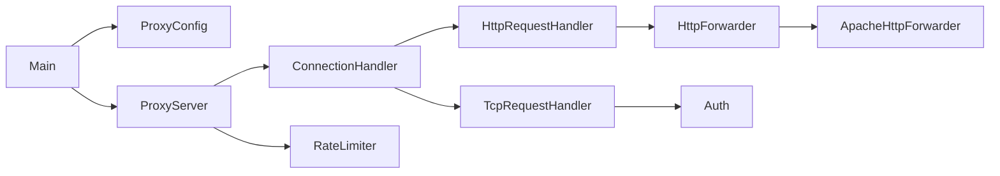

# Proxy Java — base funcional de estudo

Java 21 + Maven. Dois modos com **um destino fixo configurável**:

- **TCP**: preserva o protocolo de estudo `AUTH usuario senha\r\n`, seguido por bytes encaminhados nos dois sentidos. Não é transparente para um cliente Minecraft padrão: ele não envia esse AUTH.
- **HTTP**: reverse proxy HTTP/1.1 usando HttpCore 5.4.4. Cliente acessa o endereço do proxy; caminho, query, método, corpo e resposta seguem para o servidor configurado. Não é um forward proxy de navegador (`curl -x`).

O marco pedido de “aproximadamente 60%” significa base funcional com contratos e testes, não medição de percentual de código. As funcionalidades restantes estão no roteiro abaixo.

## Executar e experimentar HTTP

Requer JDK 21 ou superior. Compile, teste e copie a dependência de runtime:

```bash
mvn verify dependency:copy-dependencies -DincludeScope=runtime
```

Em outro terminal, abra um servidor HTTP de destino local:

```bash
python3 -m http.server 8000 --bind 127.0.0.1
```

Inicie o proxy (Linux/macOS):

```bash
PROXY_MODE=http PROXY_PORT=8080 PROXY_UPSTREAM_PORT=8000 \
  java -cp 'target/classes:target/dependency/*' com.lipe.proxy.Main
```

Teste em outro terminal:

```bash
curl -i http://127.0.0.1:8080/
```

No IntelliJ, recarregue o projeto Maven e execute `Main` com essas variáveis em **Run Configuration → Environment variables**. A IDE pode manter um modelo de dependências antigo mesmo quando `mvn verify` passa.

## Executar TCP

Inicie seu servidor TCP de destino (padrão `127.0.0.1:20000`). Configure credenciais de estudo no ambiente:

```bash
export PROXY_USERNAME=estudante
read -r -s -p 'Senha TCP: ' PROXY_PASSWORD
export PROXY_PASSWORD
PROXY_MODE=tcp java -cp 'target/classes:target/dependency/*' com.lipe.proxy.Main
```

O cliente deve enviar `AUTH estudante <senha>\r\n` antes dos bytes da aplicação. O proxy não envia ACK de login; credenciais inválidas recebem uma mensagem de erro e desconexão. AUTH e senhas em memória/texto aberto são exclusivamente parte do exercício atual.

## Configuração

| Variável | Padrão | Significado |
| --- | --- | --- |
| `PROXY_MODE` | `tcp` | `tcp` ou `http` |
| `PROXY_BIND_ADDRESS` | `127.0.0.1` | Interface de entrada |
| `PROXY_PORT` | `25565` | Porta de entrada; `0` escolhe e registra uma porta livre |
| `PROXY_UPSTREAM_HOST` | `127.0.0.1` | Host fixo de destino |
| `PROXY_UPSTREAM_PORT` | `20000` | Porta fixa de destino |
| `PROXY_TIMEOUT_MS` | `10000` | Timeout de conexão/leitura |
| `PROXY_MAX_CONNECTIONS_PER_IP` | `5` | Conexões simultâneas por endereço IPv4/IPv6 |
| `PROXY_USERNAME` | obrigatório no TCP | Usuário do protocolo AUTH |
| `PROXY_PASSWORD` | obrigatório no TCP | Senha sem espaços do protocolo AUTH |

O `.env.example` é uma referência; Java não o carrega automaticamente. No TCP, o timeout de leitura é por direção: um túnel sem tráfego em uma direção durante esse intervalo pode ser encerrado. O limite por IP é de simultaneidade, não de requisições por segundo.

## Arquitetura



`ProxyServer` controla listener, virtual threads, admissão e fechamento do cliente. Os handlers cuidam do protocolo. `HttpForwarder` separa o transporte HTTP e permite testes com falhas simuladas; quem recebe sua resposta deve fechá-la após transmitir o corpo. Os contratos são pequenos e próximos do uso; não há camadas de domínio artificiais.

Detalhes da avaliação e exercícios em [docs/architecture.md](docs/architecture.md).

## O que funciona

- [x] TCP bidirecional com half-close, preservando resposta após EOF do cliente.
- [x] Autenticação TCP sem consumir os bytes posteriores à linha AUTH.
- [x] HTTP/1.1 com destino fixo, path/query, POST e corpos por streaming, inclusive chunked.
- [x] HEAD, 204/304 e `Expect: 100-continue`.
- [x] Filtro de headers hop-by-hop e nomes indicados por `Connection`, nas duas direções.
- [x] `Host` e framing recriados para cada trecho; `Proxy-Authorization` não vaza para o destino.
- [x] Erros 400/408/417/501/502/504/505 conforme o estágio e a falha.
- [x] Contador por IP sem corrida entre admissão e remoção, incluindo IPv6.
- [x] Configuração validada, porta efêmera preservada e encerramento de listener/clientes no Ctrl+C.
- [x] Testes de concorrência, lifecycle, TCP e HTTP com sockets/servidores locais.

## Retomada: o restante do projeto

1. **Autenticação**: decidir a política HTTP (atualmente sem autenticação), adicionar testes e substituir o armazenamento de senha em texto por hash apropriado. Não reutilizar a linha AUTH no protocolo HTTP.
2. **Persistência HTTP**: várias requisições por conexão, estratégia de keep-alive e pool. Hoje cada conexão atende uma requisição e fecha; conexões upstream não são reutilizadas.
3. **HTTPS**: decidir entre reverse proxy com TLS e forward proxy com CONNECT. São requisitos diferentes. CONNECT/Upgrade/WebSocket retornam 501; HTTP/1.0 retorna 505.
4. **Limites e observabilidade**: limite global de conexões, limite de corpo e prazo total de requisição (hoje há timeout de leitura, não um prazo total), métricas e logs de falhas sem credenciais.
5. **Operação**: shutdown com espera/cancelamento explícito das tarefas upstream, testes de carga, empacotamento executável e deploy.

Não há retries automáticos (um POST não deve ser repetido silenciosamente), descoberta de destinos, balanceamento, reescrita de Location/cookies nem integração Minecraft. Se o destino falhar durante o corpo depois dos headers, o proxy fecha o fluxo: não pode substituir uma resposta parcialmente enviada por 502. Ao parar, clientes são fechados imediatamente; tarefas que aguardam o upstream podem continuar até o timeout.

## Validação

```bash
mvn verify
```

Os testes rodam localmente, sem depender de um site externo. O JAR Maven padrão não inclui dependências; use o classpath do exemplo até implementar o empacotamento executável.

Referências oficiais: [HttpCore RequesterBootstrap](https://hc.apache.org/httpcomponents-core-5.4.x/current/httpcore5/apidocs/org/apache/hc/core5/http/impl/bootstrap/RequesterBootstrap.html) e [API de conexão HTTP de servidor](https://hc.apache.org/httpcomponents-core-5.4.x/current/httpcore5/apidocs/org/apache/hc/core5/http/impl/io/DefaultBHttpServerConnection.html).
