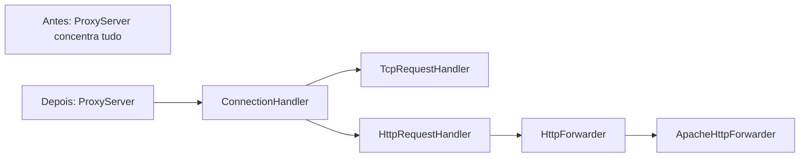

# Avaliação e decisões para retomar o estudo

## Arquitetura: composição com contratos pequenos

**Evidência no código:** antes, `ProxyServer` aceitava sockets, autenticava, conectava a `localhost:20000` e copiava bytes. `HttpForwarder` e `HttpRequestHandler` estavam vazios. O README descrevia TCP; o pedido atual introduziu HTTP.

**Diagnóstico:** implementar HTTP no mesmo método tornaria lifecycle, protocolo e destino inseparáveis. Uma conexão TCP genérica e uma requisição HTTP não são o mesmo contrato.

**Recomendação aplicada:** Strategy por composição: `ProxyServer` recebe `ConnectionHandler`. Há duas implementações reais: `TcpRequestHandler` e `HttpRequestHandler`. O segundo recebe `HttpForwarder`, implementado por `ApacheHttpForwarder`.

| Trade-off | Consequência |
| --- | --- |
| Ganho | Listener e limite por IP são compartilhados; trocar protocolo não exige modificar o accept loop. |
| Ganho | Forwarder falso permite verificar 502/504 sem rede externa; transporte real é testado com servidor local. |
| Custo | Algumas classes e interfaces adicionais; é preciso acompanhar o wiring em Main. |
| Limite deliberado | O contrato HTTP usa tipos HttpCore: não é uma porta independente de framework. Evita duplicar toda a modelagem de HTTP num projeto pequeno. |
| Quando não aplicar | Se houvesse apenas um handler trivial, extraí-lo para várias camadas e criar factories seria excesso. Não há motivo atual para Spring, DDD ou microsserviços. |



Antes:

```java
// Dentro de ProxyServer: destino e algoritmo presos ao listener.
try (Socket destination = new Socket("localhost", 20000)) {
  // Autenticar, copiar, tratar EOF...
}
```

Depois:

```java
// O listener mantém o ciclo de vida do cliente e o finally da admissão.
handler.handle(client);
// Main escolhe TCP ou HTTP e injeta o comportamento.
```

Estrutura final: `config` valida ambiente; `infra/network` concentra listener/contrato; `infra/tcp` contém o protocolo AUTH + túnel; `infra/http` contém contrato, transporte Apache, handler e política de headers; `security` contém autenticação de estudo e limite de simultaneidade.

## Revisão Java: concorrência na admissão

**Prioridade crítica — evidência:** `RateLimiter` removia um `AtomicInteger` ao chegar a zero. Outra thread podia incrementar aquele mesmo objeto antes da remoção, ficando com um contador fora do mapa.

**Correção:** operações de admissão/liberação em `ConcurrentHashMap.compute` por endereço completo. Não é necessário um design pattern adicional: atomicidade por chave resolve o problema.

Antes:

```java
// Incremento e remoção não compõem uma transação por IP.
AtomicInteger count = map.computeIfAbsent(ip, key -> new AtomicInteger());
count.incrementAndGet();
```

Depois:

```java
// Decisão e atualização ocorrem na mesma operação por endereço.
activeConnections.compute(address, (key, count) -> {
  int current = count == null ? 0 : count;
  if (current >= maxConnectionsPerIp) return count;
  admitted[0] = true;
  return current + 1;
});
```

**Trade-offs:** Integers imutáveis tornam a atualização clara e removem o contador órfão; há serialização das operações para o mesmo IP. Não adicionar locks globais, interfaces de contador ou armazenamento distribuído para esse cenário.

## Revisão Java: ownership e protocolo

**Prioridade de design — evidência:** o listener usa try-with-resources para o cliente; TCP mantém half-close em cada direção; HTTP mantém a resposta upstream aberta durante o streaming.

**Padrão:** composição/Strategy e responsabilidade explícita de recursos. O contrato `ConnectionHandler` não transfere a propriedade do cliente; `HttpForwarder.forward` transfere a responsabilidade de fechar a resposta ao chamador.

**Ganhos:** testes reais de EOF e respostas evitam tratar encerramento normal como falha; corpos não precisam caber inteiros na memória. **Custos:** streaming exige respeitar a vida útil dos streams e não permite trocar status depois dos headers. **Quando não complicar:** não construir um parser HTTP próprio nem criar DTOs duplicados só para esconder a biblioteca neste estágio.

HTTP está deliberadamente restrito a HTTP/1.1, origin-form e destino fixo. Os testes verificam POST, chunked, HEAD, 100-continue, erros e headers. O transporte recria Host, Content-Length/Transfer-Encoding e Connection para cada trecho. O modo HTTP não usa o AUTH proprietário do TCP.

## Tutor: fixação e próximos passos

**Conceito-chave:** contrato deve representar uma fronteira real de comportamento; uma interface não torna automaticamente o código desacoplado de uma biblioteca.

**Desafio prático:** implemente um `LoggingHttpForwarder` que decora `HttpForwarder`, mede tempo e registra método/status sem armazenar credenciais. Teste com um forwarder falso e escolha em Main quando ativá-lo. Isso exercita Decorator sem alterar listener ou parsing.

**Reflexão:** se a implementação Apache fosse substituída pelo cliente HTTP do JDK, quais assinaturas atuais precisariam mudar? Quando valeria a pena pagar o custo de modelos HTTP próprios?

## Tutor de arquitetura: evolução guiada

**Princípio:** separar ciclo de vida, protocolo e transporte facilita evoluir um requisito por vez.

**Missão incremental:** (1) defina e teste autenticação HTTP sem a linha AUTH; (2) implemente o decorator de métricas; (3) só então estude persistência HTTP, com dois requests no mesmo socket e falha no segundo.

**Teste de estresse arquitetural:** e se cada requisição pudesse escolher um destino? Antes de adicionar isso, decida quem autoriza o endereço e como impedir que o proxy se torne um acesso arbitrário à rede. O destino fixo atual elimina essa decisão da entrada do cliente.
